# AWA — Entity-Relationship Diagram (Firestore data model)

AWA runs on **Firestore** (a document database, not a relational one). There are no joins and no
foreign-key constraints — relationships are plain fields (`uid`, `userId`, `ownerId`) that the
security rules and app code resolve. This diagram uses ER notation anyway because that is how the
data is logically related.

## 1. ER diagram

```mermaid
erDiagram
    USERS ||--o| TOTP : "uid (1:1, 2FA secret)"
    USERS ||--o| WALLETS : "uid (1:1, simulated balance)"
    USERS ||--o{ LOGS : "uid (audit trail)"
    USERS ||--o{ NOTIFICATIONS : "userId (bell inbox)"
    USERS ||--o{ LOGIN_HISTORY : "uid (last 20 sign-ins)"
    USERS ||--o{ TRUSTED_DEVICES : "uid (owner-only rows)"
    USERS ||--o{ WEBAUTHN_CREDENTIALS : "uid (owner-only rows)"
    USERS ||--o{ FACE_DESCRIPTORS : "uid (owner-only rows)"
    USERS ||--o{ TRANSACTIONS : "from / to (wallet ledger)"
    USERS ||--o{ CHECKINS : "uid (visit record)"
    USERS ||--o{ AI_CHATS : "uid (demo chat history)"
    USERS ||--o| PUBLIC_PROFILES : "uid (safe public mirror)"
    USERS ||--o{ SUPPORT_REQUESTS : "uid (staff-assisted verification)"
    USERS ||--o{ ITEMS : "createdBy (demo CRUD)"
    WALLETS ||--o{ TRANSACTIONS : "walletId"
    ANNOUNCEMENTS }o..o| USERS : "posted by staff/admin (no author field kept)"

    USERS {
        string uid PK "Firebase Auth uid = doc id"
        string email
        string name
        string role "user(1) | staff(2) | admin(3)"
        bool active "deactivation flag"
        map prefs "textSize, dark, contrast, reduceMotion, dyslexia, ttsRate"
        timestamp createdAt
    }
    TOTP {
        string uid PK "1:1 with users"
        string secret
        bool enabled
        array recovery "SHA-256 hashes only"
        timestamp createdAt
    }
    WALLETS {
        string uid PK "1:1 with users"
        number balance "simulated"
    }
    LOGS {
        string id PK "auto"
        string uid "who did it"
        string action "snake_case, e.g. items_create"
        string details
        timestamp createdAt
    }
    NOTIFICATIONS {
        string id PK "auto"
        string userId "recipient"
        string title
        string message
        bool read
        timestamp createdAt
    }
    TRANSACTIONS {
        string id PK "auto"
        string uid "owner of this ledger row"
        string type "payment_sent | payment_received | topup"
        string toUid "payee uid (sent rows)"
        string fromUid "payer uid (received rows)"
        number amount "simulated"
        string note
        string status "simulated"
        timestamp createdAt
    }
    LOGIN_HISTORY {
        string id PK "auto"
        string uid
        string device
        string detail
        timestamp createdAt
    }
    TRUSTED_DEVICES {
        string id PK "auto"
        string uid
        string device
        string deviceId "random per-browser id"
        timestamp createdAt
    }
    WEBAUTHN_CREDENTIALS {
        string id PK "auto"
        string uid
        string name
        bytes credential "public key material only"
        timestamp createdAt
    }
    FACE_DESCRIPTORS {
        string id PK "auto"
        string uid
        array descriptor "128 numbers, never a photo"
        timestamp createdAt
    }
    CHECKINS {
        string id PK "auto"
        string uid
        string name
        string note
        timestamp createdAt
    }
    AI_CHATS {
        string id PK "auto"
        string uid
        string role "user | assistant"
        string text
        timestamp createdAt
    }
    ITEMS {
        string id PK "auto (demo entity)"
        string name
        string category
        number quantity
        string notes
        string createdBy "uid"
        timestamp createdAt
        timestamp updatedAt
    }
    ANNOUNCEMENTS {
        string id PK "auto"
        string title
        string body
        timestamp createdAt
    }
    SMS_OUTBOX {
        string id PK "auto"
        string to
        string message
        string status "simulated"
        timestamp createdAt
    }
    PUBLIC_PROFILES {
        string uid PK "same uid as users"
        string name
        string email
    }
    SUPPORT_REQUESTS {
        string id PK "auto"
        string uid "who asked for help"
        string name
        string email
        string reason "verification"
        string note
        string status "open | resolved"
        string resolvedBy "staff uid"
        timestamp createdAt
        timestamp resolvedAt
    }
```

## 2. Relationship rules (enforced in `web/firestore.rules`)

| Relationship | Rule |
|---|---|
| users | you read/write only your own doc; role changes only via console (no self-promotion) |
| owner-only rows (`totp`, `wallets`, `trusted_devices`, `webauthn_credentials`, `face_descriptors`) | `request.auth.uid == resource.data.uid` on every read/write |
| logs | write requires a signed-in uid writing their own `uid`; read staff/admin |
| notifications | recipient reads their own (`userId == auth.uid`); staff/admin can create for others |
| transactions / wallets | a normal user may only CREDIT another wallet (`walletCreditOk`), never debit it; the transfer is one atomic `writeBatch` |
| public_profiles | safe uid/name/email mirror: any signed-in user reads; only the owner writes; wallet recipients come from here instead of `users` |
| support_requests | a user files their own (`status == "open"`); staff/admin read all and resolve |
| announcements | staff/admin write; anyone signed-in reads |
| ai_chats | owner-only; read checks `resource.data.uid`, create checks `request.resource.data.uid` |
| items (demo) | signed-in users CRUD their own rows; staff/admin read all |

## 3. Notes for the grader

- **Why no junction tables?** Firestore is NoSQL: 1:N is a field on the child (`uid`), M:N
  (transactions between users) is two fields (`from`, `to`).
- **Why is `totp` 1:1?** One TOTP secret per account, doc id = uid, so lookups are O(1) and the
  rules are a simple ownership check.
- **Recovery codes are SHA-256 hashes** — the plaintext is shown once at setup, then only hashes
  are stored; codes are burned in a `runTransaction` so a code cannot be reused twice.
- **Face data is 128 numeric descriptors**, never images — privacy by design.
- Topic collections (revealed Oct 10) follow the same pattern: copy the `items` block in the rules
  and a CRUD config per entity.
